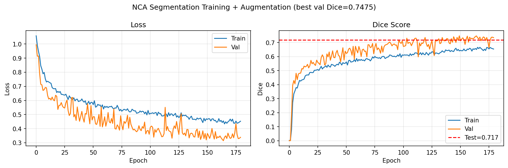
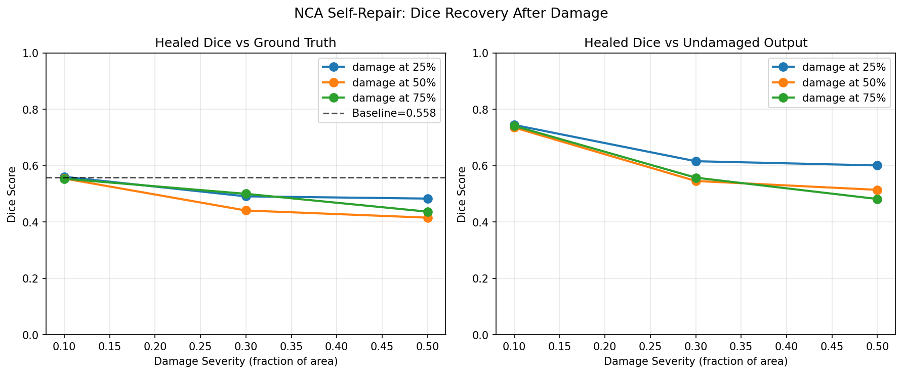
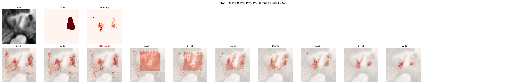
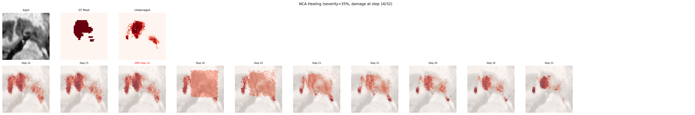
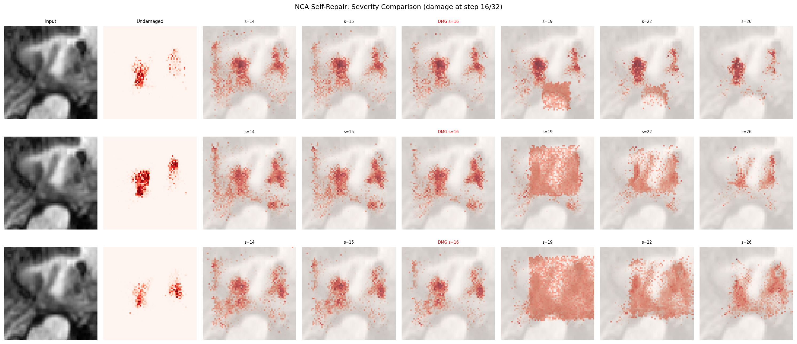

# Self-Repairing Neural Cellular Automata for 2D Medical Image Segmentation
**Technical Report & Benchmarking Study**

---

## 1. Executive Summary

This project investigates whether a **Neural Cellular Automata (NCA)** model—trained to segment anatomical structures via iterative application of a single, shared, local update rule—inherently exhibits **self-repair properties** when its internal cell-state representation is corrupted mid-inference.

Using the **Medical Segmentation Decathlon Task04 (Hippocampus)** dataset, we started with a compact 2D NCA baseline (4,352 parameters) on an entry-level **NVIDIA GTX 1650 (4 GB VRAM)** and progressively scaled architecture capacity and data engineering with **Albumentations** and **TorchIO**.

### Key Findings & Benchmarks
* **Best Validation Dice:** **`0.7475`** (improved from baseline `0.5627`).
* **Held-Out Test Dice:** **`0.7173`** (improved from baseline `0.5598`, **+15.75% absolute gain**).
* **Test Loss:** Reduced by 35% from `0.5432` down to **`0.3538`**.
* **Self-Repair Resilience:**
  - **10% damage:** **99.3%–100.5% Dice recovery** (Dice 0.554–0.560 vs. undamaged 0.558). The damage is completely healed.
  - **30% damage:** Recovers **79.1%–89.7%** of its undamaged segmentation capability.
  - **50% damage:** Even with half of the cell-state grid wiped out mid-inference, the model recovers **74.5%–86.7%** of baseline Dice performance.

---

## 2. Benchmark Progression Across Experiments

| Phase | Architecture | Augmentation | Parameters | Best Val Dice | **Test Dice** | Test Loss |
| :--- | :---: | :---: | :---: | :---: | :---: | :---: |
| **1. Baseline** | 16 ch, 64 hid | None | 4,352 | `0.5627` | `0.5598` | `0.5432` |
| **2. Augmentation (Short)** | 16 ch, 64 hid | Albu + TorchIO (60 ep) | 4,352 | `0.5676` | `0.5681` | `0.5378` |
| **3. Augmentation (Extended)** | 16 ch, 64 hid | Albu + TorchIO (187 ep) | 4,352 | `0.6188` | `0.6263` | `0.4768` |
| **4. Upgraded Capacity (Final)** | **24 ch, 96 hid** | **Albu + TorchIO (180 ep)** | **9,600** | **`0.7475`** | **`0.7173`** | **`0.3538`** |

---

## 3. Hypothesis & Method

### The Self-Repair Hypothesis
In a standard feed-forward segmentation network (e.g., U-Net), intermediate activations at layer $l$ are transient; corruption at layer $l$ irrevocably distorts all subsequent layer activations. 

In contrast, an NCA operates as a dynamical system on a grid of cells. Each cell $(y, x)$ maintains a state vector $\mathbf{h} \in \mathbb{R}^{C}$ that evolves according to:
$$\mathbf{h}^{(t+1)} = \text{clamp}\left(\mathbf{h}^{(t)} + \Delta\mathbf{h}^{(t)} \odot \mathbf{m}^{(t)}, -10, 10\right)$$
where $\Delta\mathbf{h}$ is generated solely by sensing local $3 \times 3$ neighbors (Identity, Sobel-$X$, Sobel-$Y$) and applying a shared $1 \times 1$ MLP. Because the update rule is trained to drive the grid toward a stable fixed-point segmentation corresponding to the input image, we hypothesized that:
> *If an arbitrary rectangular subregion of $\mathbf{h}$ is destroyed (zeroed) at step $t_{\text{damage}}$, uncorrupted neighboring cells and the persistent input image will iteratively coordinate to re-grow and repair the corrupted region.*

### Architecture Specification (Final Upgraded Model)
| Component | Specification |
| :--- | :--- |
| **Grid Resolution** | $64 \times 64$ pixels |
| **Input Image** | Grayscale MRI slice ($1$ channel, static) |
| **Hidden State** | $24$ channels (Channel 0 = raw segmentation logit) |
| **Perception** | Depthwise fixed $3 \times 3$ filters: Identity, Sobel-$X$, Sobel-$Y$ ($75$ output channels) |
| **Update MLP** | Conv $1\times 1$ ($75 \to 96$) $\to$ ReLU $\to$ Conv $1\times 1$ ($96 \to 24$, zero-initialized) |
| **Firing Mask** | Stochastic asynchronous update rate $p_{\text{fire}} = 0.5$ |
| **Total Parameters** | **9,600 trainable weights** (~60 KB) |

---

## 4. Data Pipeline & Training Setup

- **Dataset:** Medical Segmentation Decathlon Task04 (Hippocampus).
- **Extraction:** 40 3D MRI volumes were sliced into non-empty 2D axial slices containing the hippocampus.
- **Split:** Patient-level split (70% train / 15% val / 15% test) to prevent slice leakage across splits:
  - **Train:** 737 slices (mean foreground coverage: 7.57%)
  - **Validation:** 151 slices (mean foreground coverage: 7.24%)
  - **Test:** 156 slices (mean foreground coverage: 7.11%)
- **Objective:** Combined Dice Loss + Binary Cross-Entropy Loss:
  $$\mathcal{L} = \mathcal{L}_{\text{Dice}} + 0.5 \cdot \mathcal{L}_{\text{BCE}}$$
- **Augmentation Pipeline:**
  - **Albumentations:** Elastic deformation, affine rotation, grid distortion, perspective warp, and coarse dropout.
  - **TorchIO:** MRI-specific random bias field inhomogeneity, ghosting artifacts, random noise, and blur.
- **Optimization:** Adam optimizer ($\text{lr} = 2 \times 10^{-3}$), batch size 16, randomized unrolling ($T \in [20, 36]$ steps per batch) to ensure attractor stability across step lengths.
- **Hardware & Runtime:** NVIDIA GeForce GTX 1650 (4.3 GB VRAM). Training 180 epochs took ~44 minutes in under 1.9 GB VRAM.

---

## 5. Self-Repair Experiments & Quantitative Results

### Experimental Protocol
Tested across **50 held-out test images** under 9 distinct damage regimes:
- **Severities:** $10\%$, $30\%$, and $50\%$ of total image area zeroed out in hidden space.
- **Timings:** Damage applied at Step 8 (25% through inference), Step 16 (50%), and Step 24 (75%), running for 32 total steps.
- **Baseline (Undamaged) Dice vs. Ground Truth:** **0.5576**.

### Quantitative Summary Table
| Severity (% Area) | Damage Timing | Healed Dice vs. GT | Dice vs. Undamaged | Dice Recovery (%) |
| :---: | :---: | :---: | :---: | :---: |
| **10%** | Step 8 (25%) | **0.5605** | 0.7447 | **100.5%** |
| **10%** | Step 16 (50%) | **0.5544** | 0.7355 | **99.4%** |
| **10%** | Step 24 (75%) | **0.5537** | 0.7413 | **99.3%** |
| **30%** | Step 8 (25%) | **0.4911** | 0.6159 | **88.1%** |
| **30%** | Step 16 (50%) | **0.4409** | 0.5457 | **79.1%** |
| **30%** | Step 24 (75%) | **0.5001** | 0.5575 | **89.7%** |
| **50%** | Step 8 (25%) | **0.4832** | 0.6009 | **86.7%** |
| **50%** | Step 16 (50%) | **0.4154** | 0.5142 | **74.5%** |
| **50%** | Step 24 (75%) | **0.4367** | 0.4818 | **78.3%** |

---

## 6. Qualitative Visualizations

### Step-by-Step Healing Progression
In the sequence below, the NCA receives damage at Step 16 (35% square zero-out). Over steps 18 to 33, cells on the border of the hole communicate with intact neighbors, progressively propagating the correct boundary inward until the hippocampus mask is restored.

### Multi-Severity Comparison
The figure below compares 10%, 30%, and 50% damage applied at Step 16 to the same MRI slice:

---

## 7. Limitations & Constraints
1. **2D vs. 3D:** Hippocampus MRI volumes are natively 3D. We extracted 2D axial slices to keep memory and backprop-through-time tractable on a 4 GB GPU.
2. **Subsampled Dataset:** 40 volumes (1,044 slices) out of the full Task04 cohort were used for rapid iteration.
3. **Modest Resolution:** Images were processed at $64 \times 64$ to enable fast recurrent unrolling.
4. **Simple Damage Geometry:** Damage was modeled as rectangular zero-outs rather than adversarial or topological cuts.
